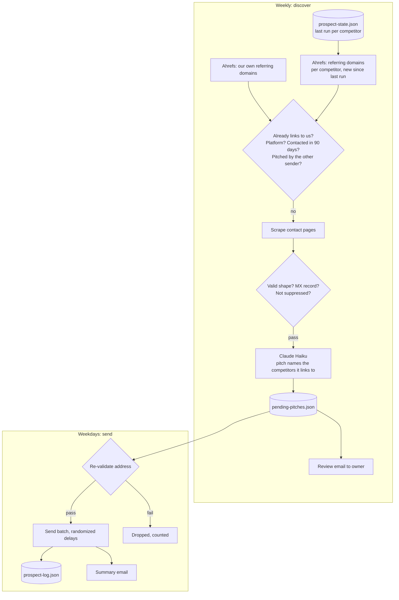

# Competitor Link Prospecting: sites that link to your competitors, found weekly and pitched in small batches

A two-mode job. Once a week it asks Ahrefs which sites have started linking to a list of competitors, removes the ones that already link to us, finds a contact at each, and drafts a pitch into a review queue. On weekdays a separate mode sends that queue a few at a time.

## The problem

The best prospects for a link or a mention are sites that already link to companies like yours. Ahrefs has that data, but it is metered, and using it carelessly is expensive:

- **Quota.** The first version ran full discovery every day and was the single biggest consumer of the monthly API allowance.
- **Lost state.** A workflow permission problem meant state never persisted. Every discovery run repeated a full sweep, and send mode never saw the pitches that discovery had drafted, so nothing was sent.
- **Overlap.** A second outreach job used the same sender address and could pitch the same site independently.

## What it does

`src/prospect.js` runs in two scheduled modes:

| Mode | Schedule | What happens |
|---|---|---|
| Discover (default) | Weekly | For each competitor, pulls referring domains that are new since the last run. Drops low-authority sites, platforms, sites that already link to us and sites contacted in the last 90 days. Finds and validates a contact email, drafts a pitch with Claude, saves it to the pending queue and emails the owner a review summary |
| `--send` | Weekdays | Re-validates each pending address, sends a small batch from the outreach mailbox with randomized delays, logs each send and emails a summary |

`--initial` runs a full first-time sweep. `--dry-run` previews without saving, and `--limit` caps the number of pitches drafted.

## Architecture



## Key design decisions

**Discovery is incremental.** The job stores the last run date per competitor and asks only for referring domains that appeared since then. A full sweep is a separate, explicit mode used once.

**Discovery and sending are separate modes on separate schedules.** The expensive, metered step runs weekly. The cheap step runs daily against a queue. Neither depends on the other succeeding in the same run.

**Persistence is treated as a correctness requirement.** The workflow comment records what happened without it: repeated full sweeps that burned the quota, and a send mode that never saw a single drafted pitch.

**The pitch is anchored in a fact.** Each pitch names the specific competitors the site already links to, which is what makes it relevant instead of generic. Company context, allowed URLs and content rules come from `config/campaign.json`, and the model may only use URLs from that list.

**Addresses are validated twice.** Once when the contact is found and again immediately before sending, because the suppression list can change between discovery and send. Dropped addresses are counted in the summary.

**API calls are retried.** Ahrefs requests retry up to three times before the competitor is skipped, and failing to fetch our own referring domains is non-fatal: the run continues without that exclusion filter and says so.

**Two senders are kept apart.** Before drafting, the job checks the partner outreach log and skips any site that job contacted within the cooldown.

**Review is built in.** Discovery ends with an email to the owner listing every drafted pitch, and its subject line is deliberately not matched by the mailbox's auto-archive filter.

## Repository layout

```
src/prospect.js             discovery, contact finding, pitch drafting, queue, send mode
src/email-validation.js     address validation, MX check, suppression list helpers
src/config.js               env + config/campaign.json loader
config/campaign.example.json  competitors, company context, allowed links, content rules
scripts/test-validation.js  offline tests for the address gates
.github/workflows/          weekly discover run and weekday send run
```

## Setup

Requires Node 20+, an Ahrefs API v3 token, an Anthropic API key and an outreach mailbox with SMTP access.

```bash
npm install
npm test                                              # offline, no keys needed
cp .env.example .env                                  # fill in values
cp config/campaign.example.json config/campaign.json  # your competitors, links and rules
npm run dry-run                                       # discover and draft, save nothing
npm run discover                                      # fill the pending queue
npm run send                                          # send a batch from the queue
```

| Variable | Purpose |
|---|---|
| `AHREFS_API_TOKEN` | Referring-domain data |
| `ANTHROPIC_API_KEY`, `CLAUDE_MODEL` | Pitch drafting |
| `OUTREACH_SMTP_HOST`, `OUTREACH_SMTP_PORT`, `OUTREACH_SMTP_USER`, `OUTREACH_SMTP_PASS`, `OUTREACH_FROM_EMAIL` | Sending from the outreach mailbox |
| `GMAIL_USER`, `GMAIL_APP_PASSWORD` | Review and summary emails |
| `SITE_DOMAIN`, `SENDER_NAME`, `SUPPRESSION_FILE`, `CONFIG_DIR`, `STATE_DIR` | Optional overrides |

Replies are handled by [ai-reply-triage](https://github.com/Michael-Wootan/ai-reply-triage) and follow-ups by [followup-sequencer](https://github.com/Michael-Wootan/followup-sequencer), which reads this job's log.

Scheduled runs are off by default. Set the repository variable `ENABLE_SCHEDULE` to `true` to turn the schedule on; manual runs from the Actions tab always work.

---

Extracted from a production automation suite I built and ran for a live e-commerce and B2B wholesale business, 2026.

© Michael Wootan. Source shared for portfolio review; all rights reserved.
